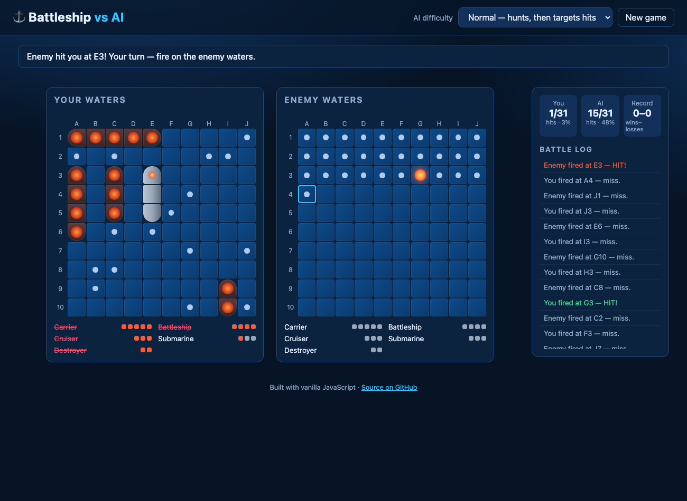

# Battleship vs AI

A browser-based Battleship game you play against a computer opponent. Pure HTML, CSS and vanilla JavaScript (ES modules), no build step and no dependencies.

**Play online:** https://vicky-526.github.io/cognition-devin-battleship-game-vs-ai/

**Bug report / debugging notes:** [BUGS.md](BUGS.md)



## How to play

1. **Place your fleet** on *Your waters*: pick a ship from the dock, then click a cell. A green preview means it fits; red means it doesn't. Press **R** (or the *Rotate* button) to switch between horizontal and vertical. Click a placed ship to pick it up again, or hit **Random** to place the whole fleet for you.
2. Click **Start battle**.
3. Click a cell on *Enemy waters* to fire. You and the AI take turns, one shot each.
4. Sink all five enemy ships (Carrier 5, Battleship 4, Cruiser 3, Submarine 3, Destroyer 2) before the AI sinks yours.

**Sound:** shots, splashes, explosions, sinking ships, ship placement, and win/lose jingles. They're generated in the browser with the Web Audio API, so there are no audio files. Use **🔊 Sound on/off** in the top bar to mute; the game remembers your choice.

**AI heat map:** with **AI heat map** ticked, your board shows where the AI is looking each turn. Brighter yellow to red cells are the ones it rates more likely to hold a ship. A pulsing crosshair marks the cell it's about to fire at. The map clears once the AI fires and is recalculated on its next turn. What the colours mean depends on the difficulty:
- Hard: how many possible placements of your remaining ships cover each cell.
- Normal and Easy: the cells it's currently choosing between.

Pick the AI difficulty from the dropdown in the top bar:

| Difficulty | Strategy | Avg. shots to sink a fleet* |
|---|---|---|
| Easy | Mostly random. Follows up a hit only half the time | ~63 |
| Normal | Hunt/target: checkerboard search, then works around hits and extends lines of hits | ~50 |
| Hard | Probability heat-map: counts every legal placement of the remaining ships and fires at the most likely cell | ~44 |

\*From 500 simulated games per level (lower is stronger).

## Run locally

```bash
npm start          # serves the folder on http://localhost:8080 (any static server works)
npm test           # unit + simulation tests (Node 18+)
```

Optional browser smoke test (Playwright):

```bash
npm i -D playwright && npx playwright install chromium
npm start &  node tests/e2e/smoke.mjs
```

## Code layout

| File | Purpose |
|---|---|
| `js/engine.js` | `Board`: ship placement, validation, shots, sinking |
| `js/ai.js` | `AIPlayer`: easy / normal / hard strategies. `plan()` returns the next shot plus the heat map behind it |
| `js/game.js` | `Game`: turn order, phases (placement → battle → over), stats |
| `js/main.js` | DOM rendering, input handling, heat-map overlay |
| `js/sound.js` | `SoundFX`: Web Audio sound effects |
| `style.css` | Ocean-themed responsive styling and hit/miss animations |
| `tests/` | `node:test` unit tests, AI simulations, and a Playwright smoke test |

The game logic (`engine`, `ai`, `game`) doesn't touch the DOM, so it runs headless under Node for tests.
